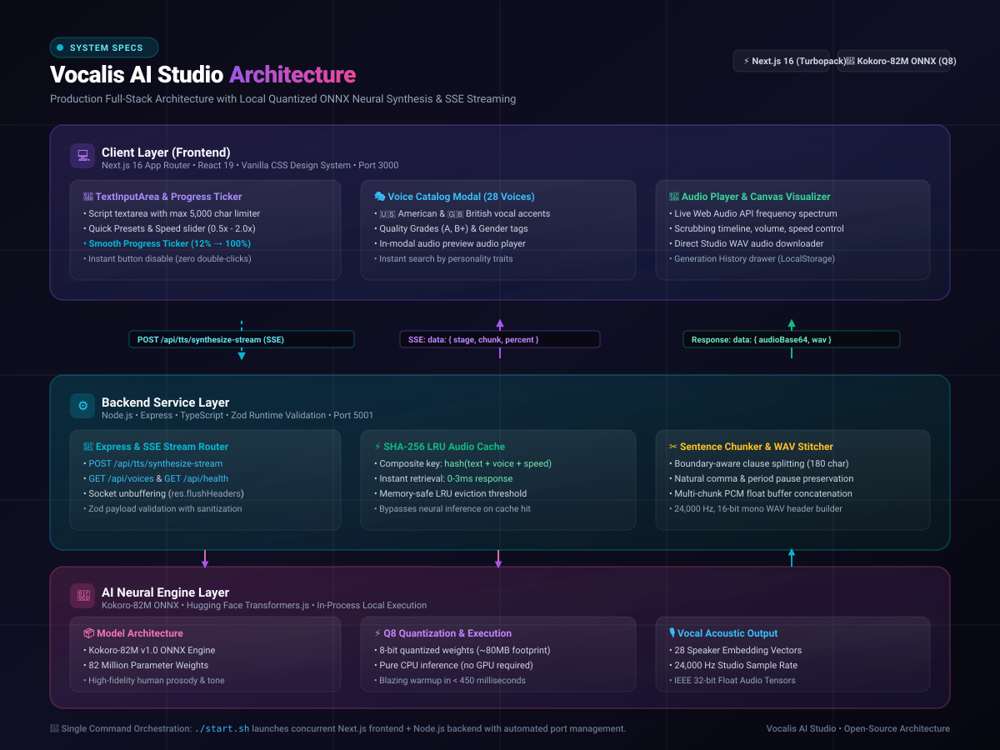
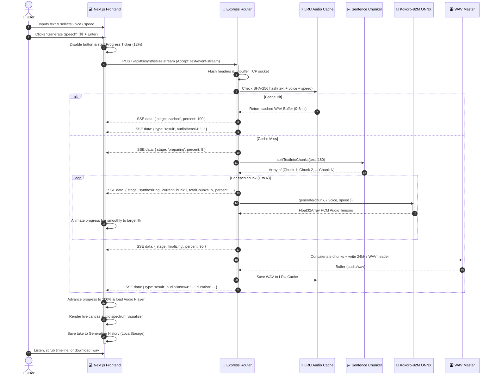

# 🏛️ Vocalis AI Studio — System Architecture

Comprehensive engineering documentation and architecture breakdown for **Vocalis AI Studio**, a full-stack, studio-grade neural text-to-speech platform powered by Next.js, Node.js TypeScript, and quantized ONNX neural models.

---

## 🗺️ High-Level Architecture Diagram



---

## 🏗️ Interactive Component Diagram

```mermaid
graph TD
    classDef client fill:#1e1b4b,stroke:#8b5cf6,stroke-width:2px,color:#fff;
    classDef network fill:#082f49,stroke:#06b6d4,stroke-width:2px,color:#fff;
    classDef backend fill:#0f172a,stroke:#3b82f6,stroke-width:2px,color:#fff;
    classDef ai fill:#2e1065,stroke:#ec4899,stroke-width:2px,color:#fff;
    classDef storage fill:#064e3b,stroke:#10b981,stroke-width:2px,color:#fff;

    subgraph ClientLayer ["💻 Client Layer (Next.js 16 + React 19)"]
        UI["Studio Workspace UI (globals.css)"]:::client
        Editor["TextInputArea & Presets"]:::client
        Ticker["Smooth Progress Ticker (12% → 100%)"]:::client
        VoiceModal["Voice Selector (28 Voices)"]:::client
        Visualizer["Canvas Audio Spectrum Analyzer"]:::client
        History["Saved Takes Library (LocalStorage)"]:::client
    end

    subgraph CommLayer ["🌐 Network & Communication"]
        SSE["Server-Sent Events (POST /synthesize-stream)"]:::network
        Direct["Direct Port 5001 + Rewrite Fallback"]:::network
        REST["REST Endpoints (/voices, /health, /samples)"]:::network
    end

    subgraph BackendLayer ["⚙️ Service Layer (Node.js & Express TypeScript)"]
        ExpressApp["Express API Router & Helmet/CORS"]:::backend
        ZodValidator["Zod Request Sanitizer & Validator"]:::backend
        Chunker["Sentence & Clause Boundary Chunker"]:::backend
        WAVStitcher["PCM Concatenator & 24kHz WAV Master"]:::backend
    end

    subgraph CacheSubsystem ["⚡ Caching Engine"]
        LRUCache["SHA-256 LRU Memory Cache (~0ms Retrieval)"]:::storage
    end

    subgraph AIEngine ["🧠 Neural Inference Engine (In-Process)"]
        ONNX["Kokoro-82M ONNX Runtime"]:::ai
        Quant["Q8 8-bit Quantized Weights (~80MB)"]:::ai
        Voices["28 Speaker Embedding Vectors"]:::ai
        AudioTensors["24,000 Hz Float32 PCM Generator"]:::ai
    end

    %% Connections
    Editor -->|Click Generate| Ticker
    Ticker -->|SSE Request| SSE
    VoiceModal -->|Browse / Preview| REST
    SSE --> ExpressApp
    REST --> ExpressApp
    ExpressApp --> ZodValidator
    ZodValidator -->|Check Cache| LRUCache
    LRUCache -.->|Cache Hit (0-3ms)| SSE
    ZodValidator -->|Cache Miss| Chunker
    Chunker -->|Chunk 1..N| ONNX
    ONNX --> Quant
    ONNX --> Voices
    ONNX --> AudioTensors
    AudioTensors --> WAVStitcher
    WAVStitcher -->|Store| LRUCache
    WAVStitcher -->|Emit SSE Chunks| SSE
    SSE -->|Stream Progress & Audio| Ticker
    Ticker --> Visualizer
    Visualizer --> History
```

---

## 🔄 End-to-End Speech Synthesis Sequence

This sequence diagram illustrates the lifecycle of a text-to-speech request from the moment the user clicks **Generate Speech**:



---

## 🧩 Architectural Deep Dive

### 1. Frontend Layer (`/frontend`)
- **Framework**: Next.js 16 (App Router) with Turbopack and React 19.
- **Design System**: Bespoke Vanilla CSS (`globals.css`) with obsidian glassmorphic styling, HSL tailored color palettes, and full Dark/Light theme switching. Zero Tailwind compiler overhead.
- **TextInputArea & Smooth Progress Ticker**:
  - Live character, word, and estimated audio duration counters.
  - Active submission locking to prevent accidental concurrent double-requests.
  - **Client-Side Progress Interpolation**: Renders continuous 60ms ticker animation from 12% to 100%, preventing static pauses while ONNX model weights process in the backend.
- **Audio Station (`AudioPlayerCard.tsx` & `AudioVisualizer.tsx`)**:
  - HTML5 Canvas Web Audio API Analyzer connecting `createMediaElementSource` to a 64-bin FFT spectrum analyzer.
  - Custom timeline scrubbing, playback rate multiplier, volume controls, and direct studio WAV exporter (`vocalis_{voice}_{title}.wav`).
- **Voice Catalog Modal (`VoiceSelectorModal.tsx`)**:
  - 28-voice interactive grid with American and British accents, quality rating tags (Grade A, B+), and in-modal voice previews.

---

### 2. Network & Communication Layer
- **Direct Backend Priority with Next.js Rewrite Fallback**:
  - Streaming requests target `http://localhost:5001/api/tts/synthesize-stream` directly to bypass reverse-proxy buffering in local development.
  - Automatic fallback to Next.js route rewrites (`/api/backend/*`) for deployment resilience.
- **Server-Sent Events (SSE)**:
  - Real-time unbuffered event stream (`X-Accel-Buffering: no`, `Content-Encoding: none`, explicit `res.flushHeaders()` and `res.flush()`).
  - Emits granular lifecycle events: `preparing` → `synthesizing` (per chunk) → `finalizing` → `done`.

---

### 3. Backend Microservice Layer (`/backend`)
- **Runtime**: Node.js with TypeScript and Express.
- **Security & Middleware**:
  - `helmet`: Cross-Origin Resource Policy enforcement.
  - `cors`: Secure origin authorization.
  - `morgan`: Request timing and operational logging.
  - `zod`: Compile-time and runtime payload validation schemas.
- **Sentence & Clause Chunker**:
  - Naturally splits scripts on sentence and clause boundaries (`.!?\n`) with a 180-character ceiling.
  - Injects acoustic pause padding (`0.12s`) between segments to ensure natural speech cadence.
- **PCM to WAV Mastering Helper (`wav.helper.ts`)**:
  - Concatenates IEEE Float32 audio chunks.
  - Writes standard 44-byte RIFF header formatted for 24,000 Hz, 16-bit mono studio audio.

---

### 4. Caching Subsystem (`cache.service.ts`)
- **Keying**: SHA-256 composite hash:
  $$\text{Key} = \text{SHA256}(\text{normalizedText} + \text{voiceId} + \text{clampedSpeed})$$
- **Performance**:
  - Cache Hit: **~0ms to 3ms** turnaround time.
  - Zero CPU neural inference required on repeated inputs.
  - Memory-safe LRU eviction ensuring the node process remains lightweight.

---

### 5. Neural Inference Engine (`kokoro.service.ts`)
- **Model**: `onnx-community/Kokoro-82M-v1.0-ONNX`.
- **Engine**: Hugging Face `@huggingface/transformers` with ONNX Runtime backend.
- **Quantization**: 8-bit Q8 quantized neural weights (~80MB footprint).
- **Execution**: Pure CPU inference with zero external GPU hardware requirements.
- **Sample Rate**: High-fidelity 24,000 Hz broadcast studio output.

---

## ⚡ Concurrency & Process Orchestration

Both services are launched concurrently with a single bash script:

```bash
./start.sh
```

- **Automated Port Conflict Detection**: Automatically inspects and frees ports `3000` and `5001` if occupied by stale processes.
- **Graceful Shutdown**: Traps `SIGINT` (`Ctrl+C`) and `SIGTERM` to safely close Express sockets, unload ONNX memory tensors, and terminate Next.js dev server instances simultaneously.
